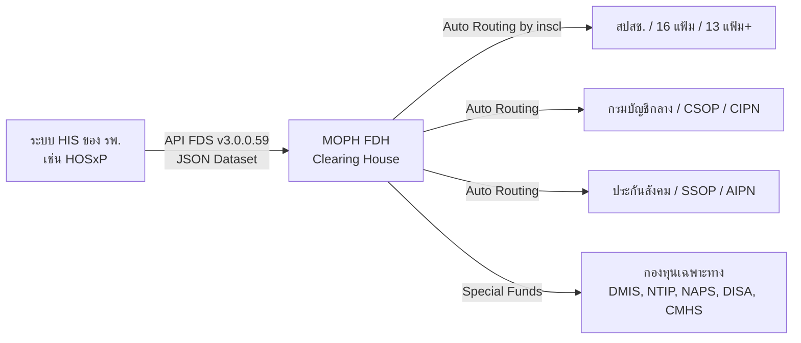

# โครงสร้างชุดข้อมูลไฟแนนเชียล ดาต้า เซต (Financial Data Set: FDS) ปรับปรุงครั้งที่ 2 พ.ศ. 2569

> **อ้างอิงเอกสารทางการ:**
> 1. เอกสารแนบท้ายประกาศสำนักงานปลัดกระทรวงสาธารณสุข เรื่อง โครงสร้างชุดข้อมูลไฟแนนเชียล ดาต้า เซต (Financial Data Set) ของระบบศูนย์กลางข้อมูลด้านการเงิน (Financial Data Hub) กระทรวงสาธารณสุข พ.ศ. 2567 ปรับปรุงครั้งที่ 2 พ.ศ. 2569 (ลงวันที่ 5 ตุลาคม 2569)
> 2. สไลด์การประชุมชี้แจง FDS 69 ปรับปรุงครั้งที่ 2/2569 วันที่ 5 ต.ค. 2569 โดย กองเศรษฐกิจสุขภาพและหลักประกันสุขภาพ สำนักงานปลัดกระทรวงสาธารณสุข
> 3. หนังสือ สป.สธ. ที่ สธ 0210.10/ว 11906 ลงวันที่ 26 สิงหาคม 2569
> 4. ข้อกำหนดทางเทคนิค API FDS Dataset v3.0.0.59 (`FDH_Dataset_v3_0_0_59.xlsx`)

---

## 1. ความเป็นมาและเป้าหมายเชิงสถาปัตยกรรม (Architecture Overview)

กระทรวงสาธารณสุขได้พัฒนาระบบ **Financial Data Hub (FDH)** ขึ้น เพื่อทำหน้าที่เป็นศูนย์กลางข้อมูลด้านการเงินและ **Clearing House** เชื่อมต่อระหว่างระบบสารสนเทศโรงพยาบาล (**Hospital Information System: HIS** เช่น HOSxP) กับกองทุนหลักประกันสุขภาพต่าง ๆ ได้แก่:
1. **สปสช. (NHSO):** กองทุนหลักประกันสุขภาพแห่งชาติ (UC/บัตรทอง) ทั้ง 16 แฟ้ม (STP, FWF) และ NHSO Digital Platform (13 แฟ้ม Plus)
2. **กรมบัญชีกลาง:** สวัสดิการรักษาพยาบาลข้าราชการ (CSMBS, CSOP, CIPN)
3. **สำนักงานประกันสังคม (SSO):** สิทธิประกันสังคม (SSOP, SSIP, AIPN)
4. **กองทุนเฉพาะทางและอื่นๆ:** กองทุนผู้ป่วยโรคไต (DMIS/CKD), กองทุนวัณโรค (NTIP), กองทุนเอดส์ (NAPS), กองทุนคนพิการและฟื้นฟูฯ (DISA), กองทุนจิตเวชชุมชน (CMHS), ประกันสุขภาพบุคคลที่มีปัญหาสถานะและสิทธิ, กองทุนคนต่างด้าว (FRG), กองทุน UCEP

### Flow การประมวลผลของ Financial Data Set (FDS v3.0.0)

---

## 2. ข้อมูลจำเพาะทางเทคนิค API (API Specification)

- **สภาพแวดล้อมทดสอบ (UAT Endpoint):**  
  `POST https://uat-fdh.inet.co.th/fdh_api/v1/dataset/import`
- **สภาพแวดล้อมจริง (Production Endpoint):**  
  `POST https://fdh.inet.co.th/fdh_api/v1/dataset/import` *(หรือตามประกาศ สป.สธ.)*
- **HTTP Method:** `POST`
- **Content-Type:** `application/json`
- **Authorization:** `Bearer <provider access token>`
- **HTTP Headers ที่สำคัญในการเชื่อมต่อ:**
  - `x-source-id`: รหัสระบุ HIS (เช่น `HOSxP`)
  - `x-sourceid-key`: Key จากการขึ้นทะเบียนระบบ NHSO Digital Platform (`hisSourceKey`)
  - `client_id`: รหัสสถานพยาบาล 5 หลัก (`hcode`)
  - `client_secret`: Token หน่วยบริการจากระบบ NewAuthenCode สปสช (`hisSecret`)

---

## 3. โครงสร้างชุดข้อมูล (Data Model Schema)

ชุดข้อมูลเป็น JSON Object แบ่งออกเป็น 2 ชั้นหลัก:
1. **METADATA ระดับบนสุด (Top-level)**: ข้อมูล Header การส่งรอบนั้นๆ และการสรุปยอดเคส (`totalVisits`)
2. **DATA ระดับ Visit (`data[]`)**: รายละเอียดประวัติการรับบริการต่อ 1 ครั้งการรักษา

### 3.1 Metadata ระดับบนสุด (Top-level Metadata)
| ฟิลด์ | บังคับ (Req) | ประเภท | คำอธิบายและเงื่อนไข |
| :--- | :---: | :---: | :--- |
| `fdhVersion` | **Y** | String | เวอร์ชันชุดข้อมูล เช่น `"3.0.0.59"` |
| `generatedDateTime` | **Y** | DateTime | วันเวลาที่สร้างชุดข้อมูล Format `YYYY-MM-DDThh:mm:ss` |
| `hcode` | **Y** | String | รหัสสถานพยาบาล 5 หลักตามทะเบียน สธ. (เช่น `"10665"`) |
| `hisSecret` | **Y** | String | Token หน่วยบริการจากระบบ NewAuthenCode สปสช. (client_secret) *(เพิ่มใหม่ใน v3.0.0.59)* |
| `hisName` | **Y** | String | ชื่อ HIS เช่น `"HOSxP"` |
| `hisSourceKey` | **Y** | String | Key จากการขึ้นทะเบียน NHSO Digital Platform (x-sourceid-key) *(เพิ่มใหม่ใน v3.0.0.59)* |
| `hisVersion` | **Y** | String | เวอร์ชันของ HIS เช่น `"4.5.2"` |
| `hospitalName` | **Y** | String | ชื่อโรงพยาบาลผู้ส่ง (Human-readable) |
| `transactionId` | **Y** | String | รหัส Unique 27 หลัก Format: `hcode(5)-YYYYMMDDHHMMSS(14)-NNNNNN(6)` เช่น `10665-20261010120000-000001` |
| `auditSoftName` | Y/N | String | ซอฟต์แวร์ที่ใช้ตรวจทานก่อนส่ง เช่น `"FDH-Audit"` / `"FDHChecker"` |
| `auditSoftVersion`| Y/N | String | เวอร์ชันของซอฟต์แวร์ Audit |
| `totalVisits` | **Y** | Object | ออบเจ็กต์สรุปจำนวนเคสแยกตามกองทุน |
| `data` | **Y** | Array | Array ของข้อมูลแต่ละ Visit (`data[]`) |

#### ออบเจ็กต์ `totalVisits`
| ฟิลด์ | บังคับ | คำอธิบาย |
| :--- | :---: | :--- |
| `total` | **Y** | จำนวน visits ทั้งหมดใน `data[]` ต้องตรงกับ `data.length` |
| `totalUcVisits` | Y/N | จำนวน visits สิทธิ UC (16 แฟ้ม และ 13 แฟ้ม Plus) |
| `totalCsopVisits`| Y/N | จำนวน visits สิทธิ CSOP (ข้าราชการ OPD กรมบัญชีกลาง) |
| `totalSsopVisits`| Y/N | จำนวน visits สิทธิ SSOP (ประกันสังคม OPD) |
| `totalCipnVisits`| Y/N | จำนวน visits สิทธิ CIPN (ข้าราชการ IPD กรมบัญชีกลาง) |
| `totalAipnVisits`| Y/N | จำนวน visits สิทธิ AIPN (ประกันสังคม IPD) |

---

### 3.2 รายละเอียดชุดข้อมูลต่อ 1 ครั้งการรักษา (`data[]`)

#### 1) ข้อมูลผู้ป่วย (`data[].patient`)
- `birthDate` (**Y**): วันเกิด `YYYY-MM-DD`
- `gender` (**Y**): เพศ `1`=ชาย, `2`=หญิง
- `hn` (**Y**): หมายเลขประจำตัวผู้ป่วย (HN)
- `id` (**Y**): เลขบัตรประชาชน 13 หลัก หรือ Passport
- `idType` (**Y**): ประเภทเอกสารตาม Code Mapping `CM-001` (`1`=บัตรประชาชน, `2`=Passport, `3`=ต่างด้าว, `4`=ใบอนุญาตทำงาน, `5`=บัตร ปกส. ต่างด้าว, `6`=คนพิการ, `9`=อื่นๆ)
- `name`:
  - `given` (**Y**): ชื่อ
  - `family` (**Y**): นามสกุล
  - `prefix` (**Y**): คำนำหน้า
  - `line` (**Y**): ชื่อ-นามสกุลรวม
- `maritalStatus` (**Y**): สถานภาพสมรสตาม `CM-002` (`1`=โสด, `2`=สมรส, `3`=หม้าย, `4`=หย่า, `5`=แยกกันอยู่, `6`=สมณะ, `9`=ไม่ระบุ)
- `nationality` (**Y**): รหัสสัญชาติ (เช่น `99`=ไทย, `48`=พม่า, `56`=ลาว, `57`=กัมพูชา)
- `occupation` (**Y**): รหัสอาชีพตามมาตรฐาน สนย.
- `address`: `city` (**Y**, รหัสจังหวัด 2 หลัก), `district` (**Y**, รหัสอำเภอ 2 หลัก), `subdistrict` (รหัสตำบล 2 หลัก), `postalCode` (**Y**), `line` (**Y**, ที่อยู่)

#### 2) ข้อมูลผู้ให้บริการ (`data[].practitioner[]`)
- `cid` (**Y**): เลขประจำตัวประชาชนของผู้ให้บริการ 13 หลัก
- `pvType` (**Y**): ประเภทผู้ให้บริการ (`1`=แพทย์, `2`=ทันตแพทย์, `3`=เภสัชกร, `4`=พยาบาล, ฯลฯ)
- `professionId` (Y/N): เลขที่ใบประกอบวิชาชีพ (เช่น ว12345, ท6789)

#### 3) ข้อมูลการรับบริการ (`data[].encounter`)
- **กรณีผู้ป่วยนอก (`encounter.opd`)**:
  - `clinic` (**Y**): รหัสคลินิก 5 หลักตาม `Code_CLINIC`
  - `dateTime` (**Y**): วันเวลาเริ่มรับบริการ `YYYY-MM-DDThh:mm:ss`
  - `seq` (**Y**): เลขที่ครั้งการรับบริการ (VN/Seq) ภายใน HN
  - `typeIn` (**Y**): ประเภทการมาตาม `CM-003` (`1`=Walk-in, `2`=ตามนัด, `3`=รับส่งต่อ)
  - `typeOut` (**Y**): สถานะการจำหน่าย OPD ตาม `CM-004` (`1`=กลับบ้าน, `2`=Admit, `3`=Refer)
  - `typeServ` (Y/N): รหัสประเภทบริการตามภาคผนวก A3 (เช่น NCD, Fast track, Home ward)
- **กรณีผู้ป่วยใน (`encounter.ipd`)**:
  - `an` (**Y**): เลขที่ผู้ป่วยใน (AN)
  - `admDateTime` (**Y**): วันเวลาที่ Admit `YYYY-MM-DDThh:mm:ss`
  - `dscDateTime` (**Y**): วันเวลาที่จำหน่าย `YYYY-MM-DDThh:mm:ss`
  - `dischStat` (**Y**): สถานะการจำหน่าย (`1`=Complete recovery, `2`=Improved, `9`=Dead)
  - `dischType` (**Y**): ประเภทการจำหน่ายตาม `CM-006` (`1`=With approval, `2`=Against advice, `3`=Escape, `4`=Transfer, `9`=Dead)
  - `dept` (**Y\***): แผนกหลัก (`01`-`12`) *(บังคับเมื่อ inscl=OFC หรือ SSS)*
  - `admType` (**Y\***): ประเภทการรับ (`A`=Accident, `E`=Emergency, `C`=Elective) *(บังคับเมื่อ OFC/SSS)*
  - `admSource` (**Y\***): แหล่งที่มา (`O`=OPD, `E`=ER, `R`=Refer) *(บังคับเมื่อ OFC/SSS)*
  - `wardDsc` (**Y\***): หอผู้ป่วยที่จำหน่าย
  - `svcType` (**Y\***): ประเภทบริการ IPD (`I`=Admit จริง, `A`=Ambulatory Care)
  - `adjRw` (**Y**), `drgCode` (**Y**), `drgVersion` (**Y**): ข้อมูล DRG ที่คำนวณได้
  - `orsFlag` (Y/N): บ่งชี้เคส Outlier (`Y`/`N`) *(เพิ่มใหม่ใน v3.0.0.59)*
  - `orsType` (Y/N): ประเภท Outlier (`COST`, `LOS`, `BOTH`) *(เพิ่มใหม่ใน v3.0.0.59)*
  - `outlierLosDays` (Y/N): จำนวนวันเกิน Mean LOS *(เพิ่มใหม่ใน v3.0.0.59)*
  - `leaveDay[]`: การลากลับบ้านระหว่าง Admit:
    - `dateTimeOut` (**Y**): วันเวลาที่ลากลับบ้าน
    - `dateTimeIn` (**Y**): วันเวลาที่กลับเข้ามา
    - `qtyDay` (**Y**): จำนวนวันที่ลา (วัน)
    - `seqLvd` (**Y**): ลำดับครั้งที่ลา
- **ข้อมูลทางคลินิก (`encounter.clinical`)**:
  - `chiefComplaint` (**Y**): อาการสำคัญ
  - `bodyWeight` (**Y\***): น้ำหนักตัว (กก.) *(บังคับในเคส IPD)*
  - `bodyHeight` (Y/N): ส่วนสูง (ซม.)
  - `comaScore` (Y/N): คะแนน GCS (3-15)
- **การวินิจฉัยโรค (`encounter.diagnosisIcd10[]`)**:
  - `dateTime` (**Y**): วันเวลาที่วินิจฉัย
  - `diagType` (**Y**): ประเภทการวินิจฉัยตาม `CM-008` (`1`=Princ, `2`=Co-morb, `3`=Compl, `4`=Other, `5`=Ext cause)
  - `icd10` (**Y**): รหัสโรค ICD-10 (ต้องไม่มีจุดทศนิยม)
  - `professionId` (**Y**): เลขใบประกอบวิชาชีพของแพทย์ผู้วินิจฉัย (วxxxx)
  - `severityLevel` (Y/N): ลำดับความรุนแรง `1`-`9` (`CM-009`)
- **หัตถการ (`encounter.procedure[]`)**:
  - `dateTimein` (**Y**), `dateTimeOut` (**Y**): เวลาเริ่มและสิ้นสุดหัตถการ
  - `clinic` (**Y**): คลินิกที่ทำ
  - `professionId` (**Y**): รหัสผู้ทำหัตถการ
  - `Oper[]`: รายการรหัส ICD-9-CM

#### 4) สิทธิประโยชน์และค่าใช้จ่าย (`data[].benefits`)
- **ข้อมูลสิทธิ (`benefits.claim`)**:
  - `hcode` (**Y**): รหัสหน่วยบริการที่รักษา
  - `hmain` (**Y**): รหัสหน่วยบริการหลักตามสิทธิ
  - `inscl` (**Y**): รหัสสิทธิการรักษาตาม `CM-010`:
    - `UCS`: บัตรทอง / หลักประกันสุขภาพแห่งชาติ
    - `OFC`: สวัสดิการรักษาพยาบาลข้าราชการ กรมบัญชีกลาง
    - `SSS`: ประกันสังคม
    - `LGO`: ข้าราชการส่วนท้องถิ่น
    - `SSI`: ประกันสังคมคนต่างด้าว
    - `FRG`: กองทุนสุขภาพบุคคลที่มีปัญหาสถานะ/ต่างด้าว
    - `PVT`: ประกันสุขภาพภาคเอกชน
  - `hType` (**Y**): ประเภทหน่วยบริการตาม `CM-011` (`1`=Main, `2`=Sub, `3`=Supra)
  - `uuc` (**Y**): การใช้สิทธิ (`1`=ใช้สิทธิ, `2`=ไม่ใช้สิทธิ ชำระเงินเอง)
  - `permitNo` (Y/N): เลขที่ Authen Code / Approval Code
  - `isUsedDm` (**Y**): มีการตรวจเบาหวานหรือไม่ (`0`=ไม่ใช่, `1`=ใช่)
  - `isUsedHt` (**Y**): มีการตรวจความดันหรือไม่ (`0`=ไม่ใช่, `1`=ใช่)
- **สรุปใบแจ้งหนี้ (`benefits.cht[]`)**:
  - `invoiceNo` (**Y**): เลขที่ใบแจ้งหนี้
  - `total` (**Y**): ยอดรวมสุทธิ
- **หมวดและรายการค่าใช้จ่าย (`benefits.cha[]`)**:
  - `invoiceNo` (**Y**): เลขที่ใบแจ้งหนี้ (FK เชื่อม `cht`)
  - `chrgItem` (**Y**): รหัสหมวดค่าใช้จ่ายมาตรฐาน FDH 2 หลัก (`11`-`K1`)
  - `amount` (**Y**): ยอดเงินรวมของหมวดนั้น
  - `date` (**Y**): วันที่คิดค่าบริการ
  - `items[]`: รายการย่อยค่ารักษา:
    - `serviceDate` (**Y**): วันเวลาที่ให้บริการ
    - `localCode` (**Y**): รหัสบริการ/ยาของโรงพยาบาล
    - `stdCode` (**Y**): รหัสมาตรฐานระดับประเทศ (TMT 24 หลัก, TMLT, ICD-9, ฯลฯ)
    - `codeSys` (**Y**): ระบบรหัสตาม `CM-014` (`TMT`, `TTMT`, `TMLT`, `ICD9CM`, `ICD10PCS`, `CSMBS`, `NHSO`, `UCEP`, `SE`)
    - `descript` (**Y**): ชื่อรายการยา/บริการ
    - `qty` (**Y**): จำนวน
    - `unitPrice` (**Y**): ราคาต่อหน่วย
    - `chargeAmt` (**Y**): ราคารวมที่เรียกเก็บ
    - `reimbPrice` (**Y**): อัตราจ่ายชดเชยที่ขอเบิกได้ตามเกณฑ์

---

## 4. โครงสร้างชุดข้อมูลกองทุนเฉพาะทาง (Special Funds Modules)

> [!NOTE]
> ฟิลด์เหล่านี้เป็น **Conditional Required**: หาก visit นั้นมีบริการของกองทุนเฉพาะทาง ต้องส่งออบเจ็กต์ที่เกี่ยวข้อง และฟิลด์ที่เป็น `Req = Y` ภายในออบเจ็กต์นั้นจะต้องมีข้อมูลครบถ้วน

### 4.1 ข้อมูลฝากครรภ์/คลอด/ทารกแรกเกิด (`pren{}`)
- `edc` (**Y**): วันกำหนดคลอด `YYYY-MM-DD`
- `gravida` (**Y**): ครรภ์ที่ (G)
- `lmp` (**Y**): ประจำเดือนครั้งสุดท้าย `YYYY-MM-DD`
- `pregnantWomenCid` (**Y**): เลขบัตรประชาชนหญิงตั้งครรภ์
- `dcipEScreen` (Y/N): การคัดกรองธาลัสซีเมีย (`28`=positive, `29`=negative, `30`=not done)
- `gaWeek` (Y/N): อายุครรภ์ (สัปดาห์)
- `husbandCid` (Y/N): เลขบัตรประชาชนสามี
- `nb[]` (Array ทารกแรกเกิด):
  - `birthDate` (**Y**): วันเกิดทารก
  - `isTwin` (**Y**): เป็นแฝดหรือไม่ (`Y`/`N`)
  - `pregnantAge` (**Y**): อายุครรภ์ตอนคลอด (สัปดาห์)
  - `newbornCid` (Y/N): เลขบัตรประชาชนทารก
  - `weight` (N): น้ำหนักแรกเกิด (กรัม)
  - `twinNo` (Y/N): ลำดับแฝด (กรณีแฝด)

### 4.2 ข้อมูลสุขภาพจิตชุมชน (`cmhs{}`)
- `dateTimeVisit` (**Y**): วันเวลาที่ประเมิน/ติดตาม `YYYY-MM-DDThh:mm:ss`
- `riskAssessResult` (**Y**): ผลการประเมินความเสี่ยง
- `smiVResult` (**Y**): ผลการประเมิน SMI-V (ผู้ป่วยจิตเวชที่มีความเสี่ยงสูงต่อการก่อความรุนแรง)
- `visitAssessResult` (**Y**): ผลการประเมินการเยี่ยมบ้าน/ติดตาม

### 4.3 ข้อมูลคนพิการและการฟื้นฟูฯ (`disa{}`)
- `defectTypeId` (**Y**): ประเภทความพิการตามมาตรฐาน (`DF1`=การเห็น, `DF2`=การได้ยิน, `DF3`=การเคลื่อนไหว, `DF4`=จิตใจ/พฤติกรรม, `DF5`=สติปัญญา, `DF6`=การเรียนรู้, `DF7`=ออทิสติก)
- `dischargeDate` (**Y**): วันที่คิดค่ารักษา/จำหน่าย/สิ้นสุดการประเมิน `YYYY-MM-DDThh:mm:ss`
- `patientIopd` (**Y**): ประเภทสถานที่รับบริการ (`O`=ผู้ป่วยนอก, `E`=นอกหน่วยบริการ/ในชุมชน)
- `targetId` (**Y**): รหัสกลุ่มเป้าหมาย (`TG1`=คนพิการ, `TG2`=ผู้สูงอายุ, `TG3`=Sub-acute 13 กลุ่มโรค, `TG4`=ผู้ป่วยติดบ้านติดเตียง, `TG5`=อื่นๆ)
- `adl` (N): คะแนน Barthel ADL Index (0-20)
- `impairment` (N): ภาวะบกพร่องกรณี IMC (1-9)

### 4.4 ข้อมูลโรคไต / ฟอกเลือด (`dmis{}`)
- `ckdStage` (**Y**): ระยะโรคไตเรื้อรัง (`3`, `4`, `5`)
- `dateApprove` (**Y**): วันที่คณะกรรมการอนุมัติสิทธิฟอกไต `YYYY-MM-DD`
- `hd{}` (Hemodialysis):
  - `dialyzerType` (Y/N): ชนิดตัวกรอง (`LowFlux`, `HighFlux`, `DblHiFlux`)
  - `hdMode` (Y/N): โหมดฟอกเลือด (`HD`, `HDF`, `HF`)
  - `membraneType` (Y/N): ชนิดเยื่อหุ้ม (`Unsubcellul`, `Subcellul`, `synthetic`)
  - `newDialyzer` (Y/N): ตัวกรองใหม่หรือไม่ (`Yes`/`No`)
  - `roundHd` (Y/N): รอบการฟอกปกติ (`Mon`, `Tue`, `Wed`, ...)
  - `vascularAccess` (Y/N): เส้นฟอกเลือด (`shunt`, `graft`, `premcath`, `tempcath`)
  - `hdServicePrice` (Y/N): ค่าบริการฟอกเลือด
- `capd{}` (ล้างไตทางช่องท้อง): `roundCapd`, `capdMode`, `dialysateConcentration`

### 4.5 ข้อมูลวัณโรค (`ntip{}`)
- `ageYearMonth` (**Y**): อายุในรูปแบบ `YYY:MMM`
- `dateRegis` (**Y**): วันที่ขึ้นทะเบียนรักษาวัณโรค
- `diagDate` (**Y**): วันที่ยืนยันการวินิจฉัย
- `diagnosisResult` (**Y**): ผลการวินิจฉัย (`TB`=เป็นวัณโรค, `NOT_TB`=ไม่เป็น)
- `dotType` (**Y**): รูปแบบการกำกับการกินยา (`D`=Direct, `V`=Video DOT, `S`=Self) *(เพิ่มใหม่ใน v3.0.0.59)*
- `regimen` (**Y**): สูตรยารักษาวัณโรค *(เพิ่มใหม่ใน v3.0.0.59)*
- `hiv_coinfection` (**Y**): มีการติดเชื้อ HIV ร่วมด้วยหรือไม่ *(เพิ่มใหม่ใน v3.0.0.59)*
- `month_number` (**Y**): เดือนของการรักษา (1, 2, 3...) *(เพิ่มใหม่ใน v3.0.0.59)*
- `dispensing[]` (Array การจ่ายยา TB):
  - `daysOfDispensation` (**Y**): จำนวนวันที่จ่ายยา (ต้อง $\le 112$ วันนับจาก Follow-up)
  - `drugId` (**Y**): รหัสยา 19 หลัก
  - `isDispensing` (**Y**): สถานะการจ่ายยาครั้งนี้ (`Y`/`N`)

### 4.6 ข้อมูล HIV / เอดส์ (`napsAdvise{}`)
- `groupService` (**Y**): กลุ่มผู้รับบริการ (เช่น `SW`, `IDU`, `MSM`, `Migrant`)
- `hcode` (**Y**): รหัสหน่วยบริการ
- `pattern` (**Y**): รูปแบบการให้คำปรึกษา
- `preTest` (**Y**), `postTest` (**Y**): ให้คำปรึกษาก่อนและหลังตรวจ (`Y`/`N`)
- `riskBehavior` (**Y**): พฤติกรรมเสี่ยง
- `serviceType` (**Y**): กลุ่มผู้ขอรับคำปรึกษา
- `vctId` (**Y**): รหัสผู้รับคำปรึกษา VCT
- `cd4_count` (Y/N), `cd4_date` (Y/N): ผลและวันที่ตรวจ CD4 *(เพิ่มใหม่ใน v3.0.0.59)*
- `viral_load` (Y/N), `vl_date` (Y/N): ผลและวันที่ตรวจ Viral Load *(เพิ่มใหม่ใน v3.0.0.59)*
- `arv_regimen` (Y/N), `arv_line` (Y/N): สูตรยาและสายการรักษา ARV *(เพิ่มใหม่ใน v3.0.0.59)*
- `prep_start_date` (Y/N): วันเริ่มยา PrEP *(เพิ่มใหม่ใน v3.0.0.59)*
- `pep_start_date` (Y/N), `pep_exposure_type` (Y/N): วันและประเภทสัมผัสสำหรับ PEP (ต้องภายใน 72 ชม.) *(เพิ่มใหม่ใน v3.0.0.59)*

---

## 5. ตารางรหัสมาตรฐานและการแปลงหมวดค่าใช้จ่าย (Code Mappings & Catalogs)

### 5.1 ตารางหมวดค่าใช้จ่าย FDH (`cha.chrgItem`) และการ Mapping ข้ามระบบ
| รหัส FDH | ความหมาย | สปสช. 16 แฟ้ม | กรมบัญชีกลาง (AIPN/CIPN) | CSOP/SSOP (BillMuad) |
| :---: | :--- | :---: | :---: | :---: |
| **11 / 12** | ค่าห้อง / ค่าอาหาร (เบิกได้ / ส่วนเกิน) | 11 / 12 | 01 | 1 |
| **21 / 22** | ค่าอวัยวะเทียมและอุปกรณ์ในการบำบัดรักษา | 21 / 22 | 02 | 2 |
| **31 / 32** | ค่ายาและสารอาหารทางเส้นเลือดที่ใช้ใน รพ. | 31 / 32 | 03 | 3 |
| **41 / 42** | ค่ายาที่นำไปใช้ต่อที่บ้าน | 41 / 42 | 04 | 3 |
| **51 / 52** | ค่าเวชภัณฑ์ที่ไม่ใช่ยา | 51 / 52 | 05 | 5 |
| **61 / 62** | ค่าบริการโลหิตและส่วนประกอบของโลหิต | 61 / 62 | 06 | 6 |
| **71 / 72** | ค่าตรวจวินิจฉัยทางเทคนิคการแพทย์ / พยาธิวิทยา | 71 / 72 | 07 | 7 |
| **81 / 82** | ค่าตรวจวินิจฉัยและรักษาทางรังสีวิทยา | 81 / 82 | 08 | 8 |
| **91 / 92** | ค่าตรวจวินิจฉัยโดยวิธีพิเศษอื่น ๆ | 91 / 92 | 09 | 9 |
| **A1 / A2** | ค่าอุปกรณ์ของใช้และเครื่องมือทางการแพทย์ | A1 / A2 | 10 | A |
| **B1 / B2** | ค่าทำหัตถการและบริการวิสัญญี | B1 / B2 | 11 | B |
| **C1 / C2** | ค่าบริการทางการพยาบาล | C1 / C2 | 12 | C |
| **D1 / D2** | ค่าบริการทางทันตกรรม | D1 / D2 | 13 | D |
| **E1 / E2** | ค่าบริการกายภาพบำบัดและเวชกรรมฟื้นฟู | E1 / E2 | 14 | E |
| **F1 / F2** | ค่าบริการฝังเข็ม / ศาสตร์การแพทย์ทางเลือก | F1 / F2 | 15 | F |
| **H1 / H2** | ค่าห้องผ่าตัดและห้องคลอด | G1 / G2 | 16 | H |
| **I1 / I2** | ค่าธรรมเนียมบุคลากรทางการแพทย์ (Doctor fee) | H1 / H2 | 17 | I |
| **G1 / G2** | ค่าบริการอื่น ๆ และส่งเสริมป้องกันโรค | I1 / I2 | 88 | G |
| **J1 / J2** | บริการอื่น ๆ ที่ยังไม่จัดหมวด | J1 / J2 | 90 | G |
| **K1** | พ.ร.บ. / Surcharge | K1 | 91 | — |

### 5.2 รหัสระบบมาตรฐาน (`cha.items.codeSys`)
- `TMT`: ยาแผนปัจจุบันตามมาตรฐานรหัสยา 24 หลัก
- `TTMT`: ยาแผนไทยและยาสมุนไพร
- `TMLT`: รหัสตรวจทางห้องปฏิบัติการทางการแพทย์ (Thai Medical Lab Terminology)
- `ICD9CM`: รหัสหัตถการ ICD-9-CM
- `ICD10PCS`: รหัสหัตถการมาตรฐานสากล
- `CSMBS`: รหัสรายการของกรมบัญชีกลาง
- `NHSO`: รหัสรายการเฉพาะของ สปสช. (เช่น Fee schedule)
- `UCEP`: รหัสรายการเบิกกรณีฉุกเฉินวิกฤต UCEP
